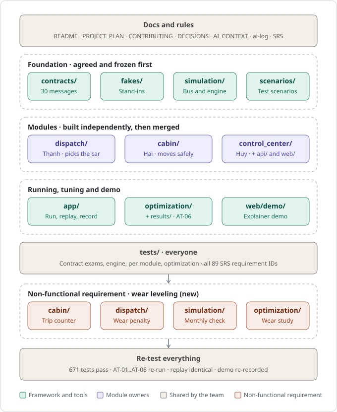

# Smart Elevator System - simulator

Software-only simulator of the Smart Elevator System described in [docs/SRS-Group2-v1.1.pdf](docs/SRS-Group2-v1.1.pdf): 40 floors, passenger cars P1-P4, goods car G1, a Dispatch controller, one Cabin controller per car, a Control Center, a deterministic simulation engine, a web UI and offline SATSA tuning.

| Read this | For |
|---|---|
| [PROJECT_PLAN.md](PROJECT_PLAN.md) | what we build, who builds it, acceptance tests |
| [CONTRIBUTING.md](CONTRIBUTING.md) | folders, Git, PRs, working with AI |
| [DECISIONS.md](DECISIONS.md) | every value the SRS leaves open (D-xx) |
| [AI_CONTEXT.md](AI_CONTEXT.md) | what to paste into your AI before you start |

## Project at a glance

What lives where, from the shared foundation to the new wear-leveling requirement:



```text
smart-elevator/
│
├── README.md              ← Front door: how to run it, status, AT-01..AT-06 results
├── PROJECT_PLAN.md        ← The build plan and who does what
├── CONTRIBUTING.md        ← Team rules: branches, PRs, contract freeze
├── DECISIONS.md           ← D-01..D-79: every gap in the SRS and what we decided
├── AI_CONTEXT.md          ← Shared prompt context every AI session starts from
├── requirements.txt       ← fastapi, uvicorn, httpx, pytest, ruff (pinned)
├── pyproject.toml         ← ruff + pytest settings
├── .gitignore
├── docs/                  ← The SRS we implemented, and these diagrams
├── ai-log/                ← How we used AI: what it did, what it got wrong
│
├── contracts/             ← Shared language of all modules, contract v1
│   ├── messages.py        ← The 30 message types
│   ├── interfaces.py      ← What every module must implement
│   ├── config.py          ← SRS constants (2 s/floor, DELAY_CAP 10 s, 1000 kg, wear limits ...)
│   ├── ui.py              ← Snapshot + REST commands for the UI
│   └── runtime.py         ← SimControl: how the API drives the engine
├── fakes/                 ← Stand-in Dispatch / Cabin / Control Center
├── simulation/            ← Deterministic bus, engine, virtual passengers, metrics
├── scenarios/             ← AT-01..AT-05, DEMO, seeded random traffic
├── app/                   ← Web server, headless run, replay, demo recorder
│
├── dispatch/              ← [Thanh] Decides which car serves each call (wear-aware)
├── cabin/                 ← [Hai] One per car: motion, doors, safety checks, trip counter
├── control_center/        ← [Huy] Roles, missions, alerts, recovery, policy approval
├── api/                   ← [Huy] FastAPI: REST commands + live snapshots
├── web/                   ← [Huy] Control-room UI (index.html, app.js, style.css)
│   └── demo/              ← "How the code works" explainer, recorded from real runs
│
├── optimization/          ← Metrics, evaluator, grid search, SATSA, wear study
├── results/               ← AT-06 tuning report and wear (NFR) report
│
├── tests/                 ← All 89 SRS requirement IDs covered
│   ├── contract/          ← Contract exams every module must pass
│   ├── engine/            ← Engine, app, metrics, requirements, wear, demo
│   ├── dispatch/          ← [Thanh]
│   ├── cabin/             ← [Hai] Unit, edge-case and whole-system tests + reports
│   ├── control_center/    ← [Huy] Unit + API tests
│   └── optimization/      ← Search, evaluator, wear report
│
├── Non-functional requirement: wear leveling (new, DECISIONS D-71..D-79)
│   ├── cabin/cabin.py             ← Trip counter in every telemetry message
│   ├── dispatch/controller.py     ← Wear penalty on the pickup ETA
│   ├── simulation/metrics.py      ← Month-end check, maintenance left out
│   └── optimization/wear.py       ← Wear study → results/wear.md
│
└── Re-test everything     ← 671 tests pass · AT-01..AT-06 re-run · replay identical · demo re-recorded
```

## Setup

```bash
python3 -m venv .venv && source .venv/bin/activate   # Python >= 3.12
pip install -r requirements.txt
```

## Commands

Every command below was run on the current `main` content; the comment shows what to expect.

```bash
pytest                                     # all tests (about 4 minutes)
```

```bash
pytest --fakes                             # also runs the fake_ok contract tests against fakes/
```

```bash
pytest tests/contract/test_cabin.py        # one module's exam
```

```bash
ruff check . && ruff format --check .      # lint + format check
```

```bash
python -m app.headless --scenario AT-01    # 8.0 HALL_CALL_SERVED, 58.0 DEST_SERVED, 64.0 doors closed at floor 5
```

```bash
python -m app.headless --scenario AT-03 --trace trace.jsonl --log log.jsonl
```

```bash
python -m app.headless --replay trace.jsonl   # prints "replay: IDENTICAL"
```

```bash
python -m app                              # web UI on http://localhost:8000 (DEMO scenario)
```

```bash
python -m app.demo                         # re-record the explainer from real runs -> web/demo/stories.js (3 s)
```

```bash
python -m http.server 8765 -d web          # then open http://localhost:8765/demo/ (no API needed)
```

```bash
python -m optimization --method compare --quick   # AT-06 on one short trace each, about 20 s
```

```bash
python -m optimization --method compare           # AT-06 in full (55 pairs x 5 traces), about 6 minutes on 8 cores; writes results/
```

```bash
python -m optimization.wear                       # wear NFR: shortened months, balancing on / off / maintenance; writes results/wear.md
```

Module flags for both entry points: `--dispatch`, `--cabin`, `--cc` = `auto` (default: the real package if it exists, otherwise the fake) | `real` | `fake`. Example: `python -m app.headless --scenario AT-01 --cabin real --dispatch fake --cc fake`.

Scenarios: `AT-01`, `AT-02`, `AT-03`, `AT-04`, `AT-05-ack-lost`, `AT-05-unsafe`, `DEMO`, `TRAIN-1`..`TRAIN-5`, `HOLDOUT-101`..`HOLDOUT-105`, `QUICK-1`, `RANDOM` (uses the seed given to reset). See `scenarios/`.

## Repository layout

| Folder | Owner | What |
|---|---|---|
| `contracts/` | An | messages, enums, config, routing, interfaces, UI and runtime contracts |
| `fakes/` | An | simple stand-ins for each module (not reference implementations) |
| `simulation/` | An | bus, engine (states, reset, log, replay), virtual passengers, scenario types |
| `scenarios/` | An | AT-01..AT-05, DEMO, seeded random traffic (training / held-out) |
| `app/` | An | `python -m app`, `python -m app.headless`, real-time runner |
| `optimization/` | An | metrics, evaluator, grid search, SATSA, AT-06 report (`python -m optimization`) |
| `results/` | An | committed output of the full AT-06 study |
| `tests/contract/`, `tests/engine/`, `tests/optimization/` | An | contract exams for each module; engine, app and optimization tests |
| `dispatch/`, `tests/dispatch/` | Thanh | Dispatch controller |
| `cabin/`, `tests/cabin/` | Hai | Cabin controller |
| `control_center/`, `api/`, `web/`, `tests/control_center/` | Huy | Control Center, REST/WebSocket API, UI |

## Wear leveling (new non-functional requirement)

Steve's e-mail asks that the cars wear evenly: the floors travelled by the units may differ by under 2 % a month, at most 5 % in 6 months, with the trip counter reset every 6 months. The team's reading is in [DECISIONS.md](DECISIONS.md) D-71..D-79: compare P1-P4 only (G1 runs freight missions only), spread = (max - min) / max of the trip counters, checked at every month end against **5 %** (D-76 relaxes the e-mail's 2 %; to confirm with Steve), counters accumulate and reset every 6 months, a car in maintenance is left out of that month.

How it works: each Cabin counts the floors it travels (`trip_floors` in its telemetry); the engine sends `TripCounterReset` every 6 months; Dispatch adds a wear penalty to a more-worn car's pickup ETA (0.2 s per floor it is ahead, at most 8 s, so no call waits more than 8 s longer); `simulation/metrics.py` closes every month and records the spread; the console shows the counters and the month's spread.

Results from [results/wear.md](results/wear.md) (`python -m optimization.wear`, months shortened to 2 hours of traffic, 7 months so the 6-month reset is included):

| Run | Worst month-end spread | Months over 5 % | Mean wait |
|---|---|---|---|
| Balanced, seed 1 / seed 2 | 2.66 % / 3.92 % | 0 / 0 | 54.8 s / 58.5 s |
| Unbalanced, seed 1 / seed 2 | 6.15 % / 3.50 % | 1 / 0 | 55.4 s / 58.1 s |
| Balanced, P3 in maintenance in month 2 | 25.55 % | 3 | 70.7 s |

What this shows, without over-claiming:

- With balancing every month stayed under 5 %; without it one month failed. In 2-hour months randomness dominates, so balancing does not lower the spread every time (seed 2). A real month has about 50 times more trips; the random part shrinks accordingly.
- **Open point:** after a month of maintenance a car is a whole month of travel behind. The capped penalty cannot close that gap, so months 4-6 failed until the 6-month reset. D-75 needs a rule for a car coming back (see DECISIONS D-75).

## Explainer demo: how the code works

`web/demo/` (also at http://localhost:8000/demo/ when `python -m app` runs) replays six
stories recorded from the real modules: a normal minute, AT-01, AT-02, AT-03, and two of
Hai's system tests (SY-24 breakdown, SY-04 crowd with an overload). On the left, the four
modules as color-coded lanes; for every message, what each one received or sent, the
functions that ran (file and line) and what they decided: Dispatch's ETA per car and the
DELAY_CAP check, the Cabin's eight checks in `validate()`, the door state machine, Control
Center's permission check. On the right, the building at the same moment.

Nothing on the page is drawn by hand: `python -m app.demo` runs each scenario with a
profiler on the modules and writes `web/demo/stories.js`. `tests/engine/test_demo.py`
checks the recorded decisions against the SRS oracles and that every code pointer still
lands on its `def` line (re-record after changing module code).

Keys: Space play/pause, Left/Right one message, 1-6 stories. "Pause at key moments" stops
on each captioned step; "show state reports" adds the cars' telemetry messages.

## Status

| Part | Status |
|---|---|
| Framework F1-F11: contracts, fakes, contract tests, engine, app, AI context (An) | done, merged, contract v1 frozen |
| Dispatch (Thanh), Cabin (Hai), Control Center + API + UI (Huy) | done; every contract test passes on the real modules |
| System tests across all real modules (Hai, `tests/cabin/test_system_*.py`) | done |
| Metrics, random traffic, evaluator, grid search, SATSA, UI optimization flow (AN-03..AN-07) | done |
| Wear leveling NFR (D-71..D-79): trip counters, Dispatch balancing, monthly check, study | done; open point: a car back from a long maintenance (D-75) |
| Real gRPC transport, real authentication, real-world fire procedures | deferred by design (PROJECT_PLAN Section 1) |

Acceptance tests on the **real** modules (`python -m app.headless --scenario <name>`):

| Test | SRS oracle | Result |
|---|---|---|
| AT-01 | pickup 8 s, arrival at 5 at 58 s, doors closed 64 s | PASS (8 / 58 / 64) |
| AT-02 | 29 picked up at 4 s, 27 at 14 s | PASS (4 / 14) |
| AT-03 | P1 = 90, P2 = 20, P4 = 58; P2 chosen; P3, G1 excluded | PASS |
| AT-04 | 44 / 50 / 58 / 64 / 122 s, no ordinary stops on the leg | PASS (LOADED confirmed at 60 s) |
| AT-05 | lost ACK / unsafe cabin: never two owners | PASS (both variants) |
| AT-06 | every (R, W) valid or rejected; SATSA vs grid vs (3, 5) on held-out traces | PASS: all 55 pairs valid, comparison in [results/optimization.md](results/optimization.md) |

`pytest` on the merged code: 671 passed, 1 skipped (the "no api/ yet" check). The full suite takes about 2-4 minutes because of the system stress tests.

Requirement traceability: each of the 89 requirement IDs of the SRS (SYS, REQ, DC, CB, MOVE, DOOR, SEN, MED, FRT, EMG, SAF, CC, SEC, OPT, SIM, UI, LOG, NFR) is named by at least one test function; the ones no module suite covered are in `tests/engine/test_requirements.py`.

## Tuning results (AT-06, held-out traces)

From [results/optimization.md](results/optimization.md) (5 training and 5 held-out traces of 30 minutes, real modules, wear balancing D-78 on). Lower J is better.

| Configuration | J (held-out) | Mean wait | P95 wait |
|---|---|---|---|
| Fixed (R, W) = (3, 5) | 117.9 | 54.1 s | 127.8 s |
| Grid search best (5, 7) | 112.3 | 51.3 s | 122.0 s |
| SATSA best, seed 0: (2, 8) | 120.7 | 54.7 s | 131.9 s |
| SWEEP baseline | 102.6 | 45.6 s | 113.9 s |
| FIRST_IDLE baseline | 316.8 | 165.1 s | 303.4 s |

What this shows, without over-claiming:

- Tuning (R, W) by grid search lowered held-out J by about 5 % against the fixed (3, 5).
- SATSA used 30 simulated pairs instead of 55. With seed 0 it stopped on a flat region and its choice did worse than (3, 5) on held-out traces; over 20 seeds it found the grid's optimum 13 times. The J surface is flat in large areas, which suits an exhaustive search of this small domain better.
- The directional SWEEP baseline waited less than our commitment-aware dispatcher on this traffic. It also delayed committed stops more often (late commitments 158 vs 151 over the 5 traces). Our dispatcher never broke DELAY_CAP in any run.
- No configuration was rejected; no run had a double owner or a door-interlock breach.
- Re-run on 17/11/2026 after the wear rule (D-78) was added: J for (3, 5) moved from 119.4 to 117.9, so balancing the wear did not cost waiting time on these traces. The two baselines do not use the rule and gave the same numbers.

